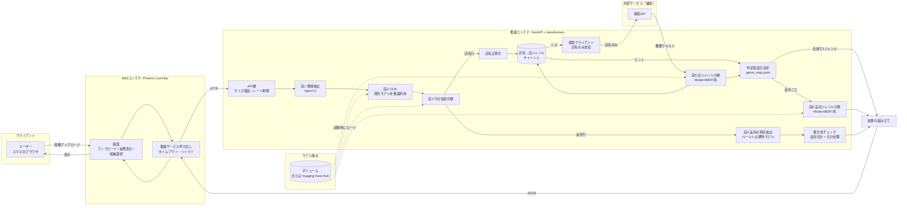
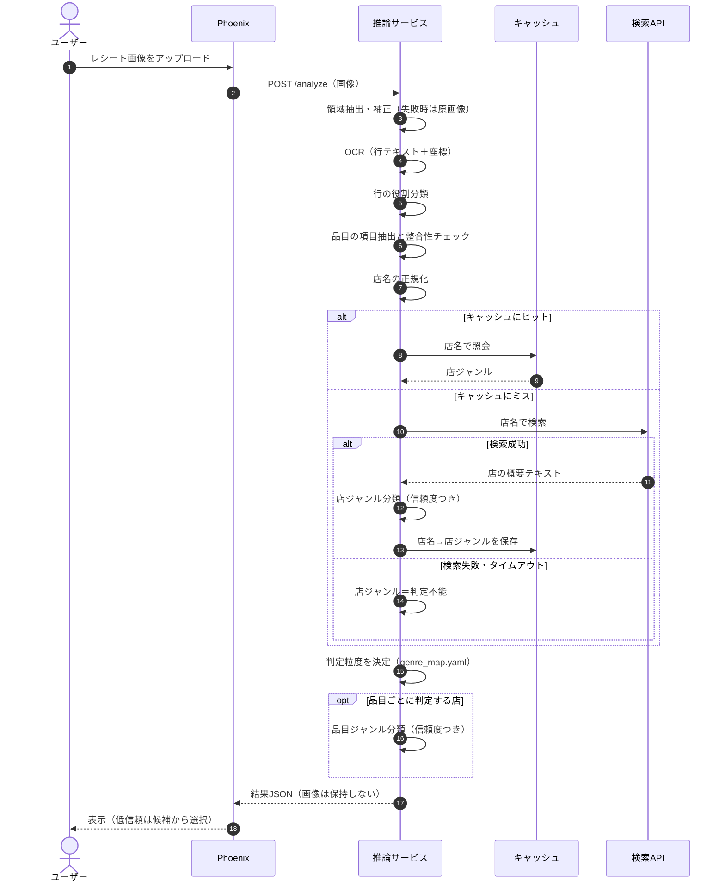
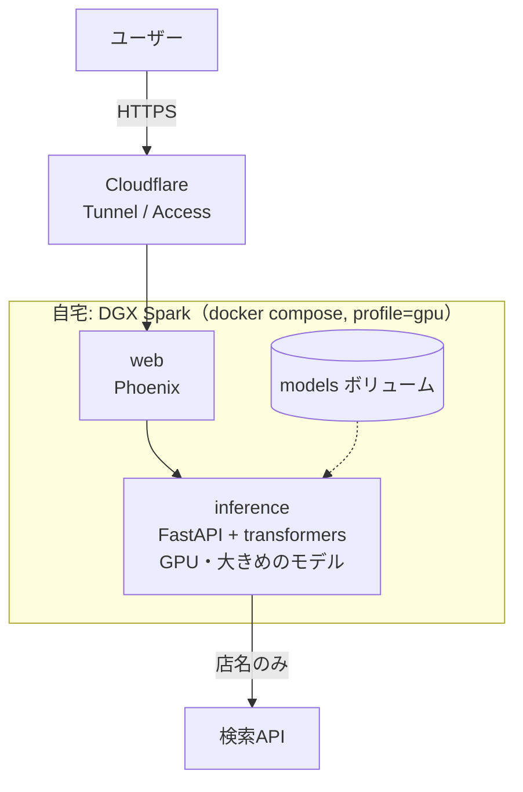
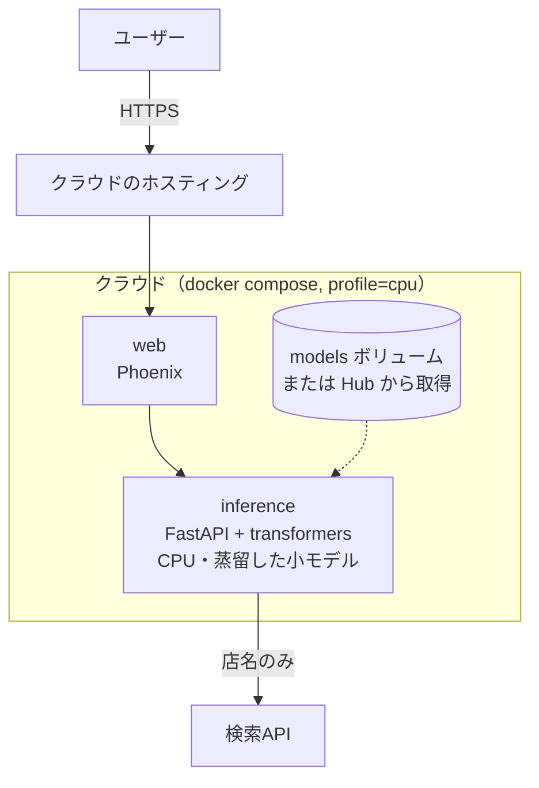
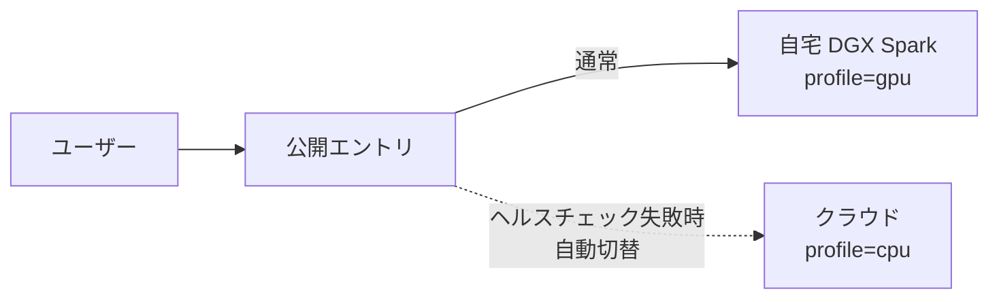
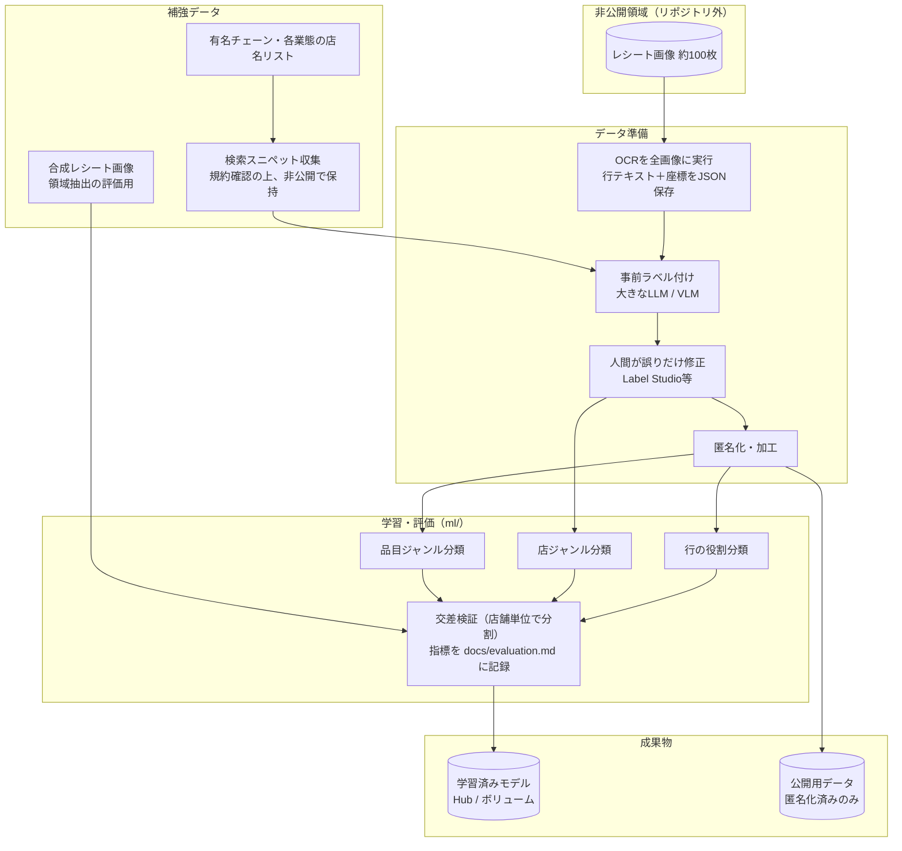

# システム構成図

| 項目 | 内容 |
|---|---|
| 版 | v0.1（ドラフト） |
| 作成日 | 2026-10-23 |
| 関連文書 | `docs/requirements.md` |

> デプロイ方針（A/B/C）は1on1での確認結果で確定する。ここでは3方針すべてに対応できる構成として記述する。

---

## 1. 論理構成（コンポーネント図）



**ポイント**

- 外部サービスは検索APIのみ。判定の本体（段2〜6）はすべて推論コンテナ内の自前コードで動く
- 検索に送るのは店名だけで、画像やレシートの他の情報は外部に出ない
- キャッシュにより、同じ店は再検索しない。検索失敗時はキャッシュ、なければ「判定不能」で縮退する

---

## 2. 推論シーケンス（1枚のレシート処理）



---

## 3. デプロイ構成

### 3.1 方針A: 自宅公開型（DGX Spark）



### 3.2 方針B: クラウド完結型（軽量CPU構成）



### 3.3 方針C: 二段構え



> 切り替えの実現手段（DNSフェイルオーバー、ロードバランサ、フロント側のフォールバック等）は未決。1on1の回答後に決める。

---

## 4. 学習・データ作成パイプライン（DGX Spark）



**ポイント**

- 実レシート画像とスニペット本文は、リポジトリに含めない（非公開領域で保持）
- 公開するのは、コード、匿名化済みのラベル付きテキスト、学習済みモデル、ラベル仕様書
- 大モデルでの事前ラベル付けは「実験・データ作成」用途。デプロイ物の推論には使わない

---

## 5. ディレクトリ構成（案）

```text
receipt-app/
├── CLAUDE.md
├── README.md
├── docker-compose.yml          # profiles: gpu / cpu
├── .env.example
├── .gitignore
├── config/
│   ├── genre_map.yaml          # 店ジャンル→判定粒度の対応表
│   ├── labels.yaml             # 店ジャンル・品目ジャンル・行ラベルの定義
│   └── thresholds.yaml         # 信頼度の閾値
├── docs/
│   ├── requirements.md
│   ├── architecture.md
│   ├── evaluation.md           # 評価指標と目標値、結果
│   ├── label_guide.md          # ラベル仕様
│   └── data_sources.md         # データ出典・ライセンス
├── ml/
│   ├── notebooks/              # 学習・分析ノートブック（消さずに残す）
│   ├── scripts/                # 学習・評価・データ作成スクリプト
│   ├── configs/                # 学習設定（シード・ハイパーパラメータ）
│   └── data/
│       ├── private/            # 実レシート・スニペット（gitignore）
│       └── public/             # 匿名化済み・合成データ
├── inference/
│   ├── Dockerfile.gpu
│   ├── Dockerfile.cpu
│   ├── pyproject.toml
│   ├── src/receipt_app/
│   │   ├── main.py             # FastAPI
│   │   ├── pipeline.py         # 段の組み立て
│   │   ├── stages/             # 段1〜6を個別モジュールで実装
│   │   ├── search.py           # 検索クライアント（店名のみ）
│   │   └── cache.py
│   └── tests/
├── web/                        # Phoenix LiveView
│   ├── Dockerfile
│   └── ...
└── samples/                    # 架空レシート画像（デモ用）
```
