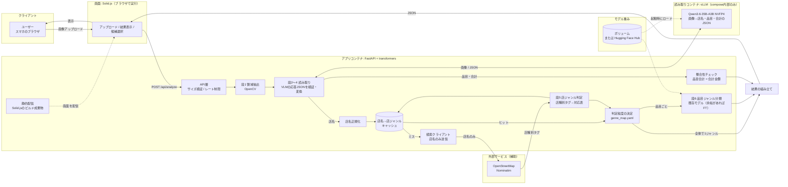
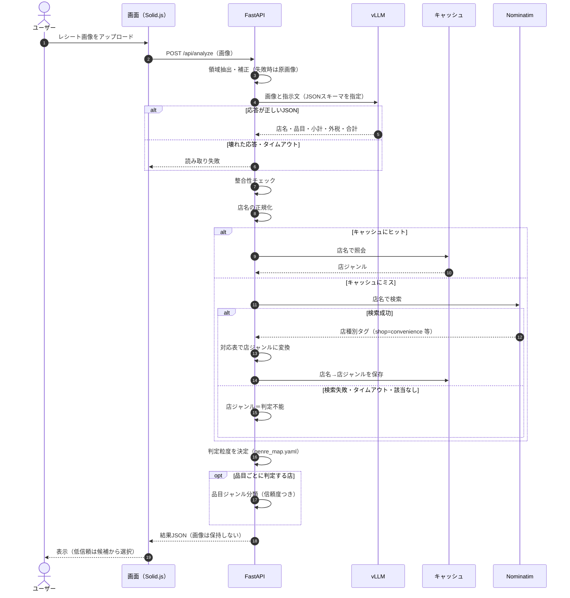
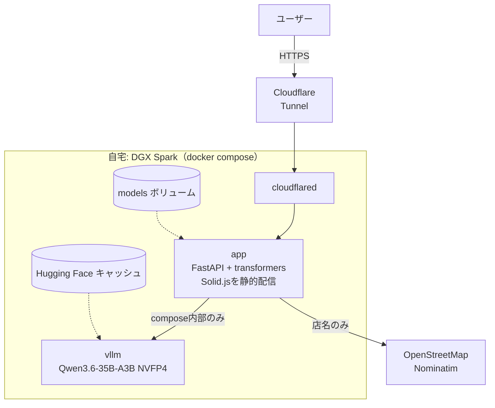
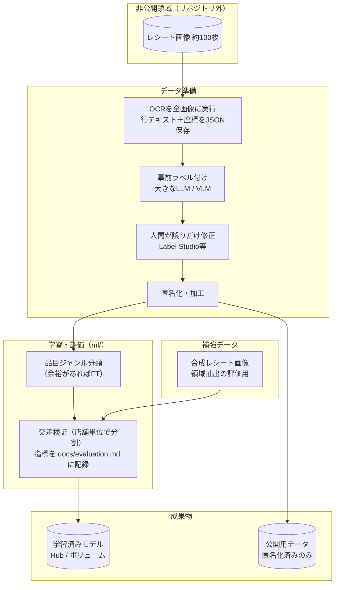

# システム構成図

| 項目 | 内容 |
|---|---|
| 版 | v0.2（2026-10-23 方針決定を反映） |
| 作成日 | 2026-10-23 |
| 関連文書 | `docs/requirements.md` |

> デプロイは方針A（DGX Spark＋Cloudflare Tunnel）に確定。フロントはSolid.jsで、FastAPIから静的配信する。店ジャンルはOpenStreetMap（Nominatim）の店種別タグ＋対応表で判定する。

---

## 1. 論理構成（コンポーネント図）



**ポイント**

- 外部サービスはOpenStreetMapの店舗検索のみ。読み取りと品目ジャンル分類は、DGX Spark 上の自前のコンテナで動く
- 読み取りは、旧方式（OCR→行の組み立て→ルールのパーサ）から視覚言語モデルに置き換えた（2026-10-30）。旧方式のコードは `stages/` に残し、比較に使う
- 検索に送るのは店名だけで、画像やレシートの他の情報は外部に出ない
- キャッシュにより、同じ店は再検索しない。検索失敗時はキャッシュ、なければ「判定不能」で縮退する

---

## 2. 推論シーケンス（1枚のレシート処理）



---

## 3. デプロイ構成（方針A: DGX Spark＋Cloudflare Tunnel）



- 各サービスに `restart: unless-stopped` を付け、DGX Sparkの再起動後に自動で復帰させる
- vLLM は CPU と GPU で共有するメモリを起動時に計測する。他のプロセスの増減で計測が揺れて失敗するので、KV キャッシュの量と使用率の上限を固定する
- クラウドでのCPU構成（旧方針B・C）は採用しない

---

## 4. 学習・データ作成パイプライン（DGX Spark）



**ポイント**

- 実レシート画像は、リポジトリに含めない（非公開領域で保持）
- 公開するのは、コード、匿名化済みのラベル付きテキスト、学習済みモデル、ラベル仕様書
- 大モデルでの事前ラベル付けは「実験・データ作成」用途。デプロイ物の推論には使わない

---

## 5. ディレクトリ構成（案）

```text
receipt-tagger/
├── CLAUDE.md
├── README.md
├── docker-compose.yml          # app + vllm + cloudflared
├── .env.example
├── .gitignore
├── config/
│   ├── genre_map.yaml          # 店種別タグ→店ジャンル、店ジャンル→判定粒度の対応表
│   ├── labels.yaml             # 店ジャンル・品目ジャンル・行ラベルの定義
│   └── thresholds.yaml         # 信頼度の閾値
├── docs/
│   ├── requirements.md
│   ├── architecture.md
│   ├── evaluation.md           # 評価指標と目標値、結果
│   ├── label_guide.md          # ラベル仕様
│   └── data_sources.md         # データ出典・ライセンス
├── ml/
│   ├── notebooks/              # 学習・分析ノートブック（消さずに残す）
│   ├── scripts/                # 学習・評価・データ作成スクリプト
│   ├── configs/                # 学習設定（シード・ハイパーパラメータ）
│   └── data/
│       ├── private/            # 実レシートとその派生データ（gitignore）
│       └── public/             # 匿名化済み・合成データ
├── inference/
│   ├── Dockerfile              # Solid.jsのビルドも含むマルチステージ
│   ├── pyproject.toml
│   ├── src/receipt_app/
│   │   ├── main.py             # FastAPI（APIと静的配信）
│   │   ├── pipeline.py         # 段の組み立て
│   │   ├── stages/             # 段1〜6を個別モジュールで実装
│   │   ├── config.py           # config/*.yaml の読み込み
│   │   └── search.py           # Nominatimクライアント（店名のみ）とキャッシュ
│   └── tests/
├── frontend/                   # Solid.js（Vite）
│   └── ...
└── samples/                    # 架空レシート画像（デモ用）
```
